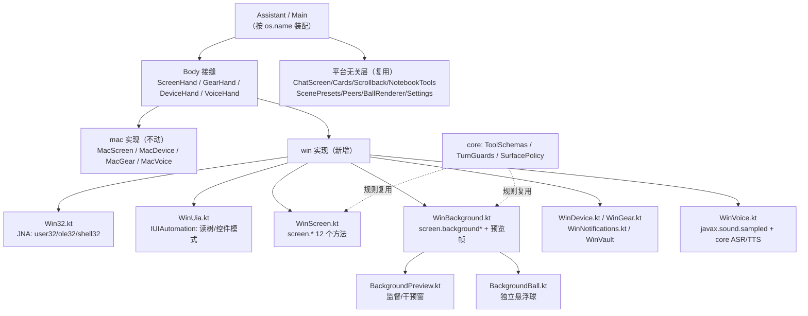

## Product Overview

把现有桌面版（macOS）完整移植为 Windows 11 版本：同一套界面与交互、同一个大脑、同一套工具协议，在本机操作 Windows 应用；「副屏」以用户选定的语义实现——用 UI Automation 在不把窗口抢到前台的前提下操作目标应用，并配一个与手机版一致的监督/干预预览窗。

## Core Features

- 界面与交互完全对齐：主对话窗口、卡片、回溯、笔记本/待办/场景、设置页、悬浮球，视觉与文案沿用现有实现
- 本机操作：读取窗口的 UI 元素树（e 号 + 0-1000 坐标 + 8×12 瞄准网格）、点击/长按/滑动/输入/提交、整屏截图与区域放大、系统动作（返回/主页/音量等）
- 副屏：锁定一个目标窗口，优先用控件模式（Invoke/Value/Selection）无焦点操作，退化路径为消息投递；独立悬浮球显示目标应用图标、可拖动、贴边自动降透明度并隐藏一半、长按换档；点球进入监督窗，可看帧、点画面即真点、发送返回键、输入文字、关闭副屏；设置里能看到正在运行的副屏并一键关闭全部
- 语音：麦克风采集与识别、TTS 播报（TTS 已在共享层跨平台）
- 手机互联：局域网发现与配对，电脑可把任务派给手机执行
- 交付：MSI 安装包、开机自启、托盘常驻，悬浮球随叫随到
- 边界与诚实：金融/支付/游戏/抢购默认不放副屏，用户黑白名单优先；untrusted 回合完全不能用副屏；被拒即失败并说明原因，不偷偷回退到前台；管理员权限窗口、GPU 合成窗口等不可操作的情形如实上报


## Tech Stack

- 语言与 UI：Kotlin/JVM + Compose Desktop（沿用现有，不引入新框架）
- 平台能力：JNA 5.14 直连 Win32（user32/kernel32/ole32/shell32/dwmapi）与 UI Automation（`uiautomationcore.dll` 的 COM 接口，vtable 调用）
- 网络与互联：JmDNS（已在用，纯 Java，Windows 可直接跑）、Java-WebSocket
- 渲染：LWJGL 3.3.4 + OpenGL（现有离屏球渲染器），natives 换成 `natives-windows`
- 打包：jpackage（Compose `TargetFormat.Msi`），前置依赖 WiX Toolset 3.14（`candle.exe`/`light.exe`）；托盘用 AWT `SystemTray`

## Implementation Approach

核心策略是**只重写"身体"，不动"大脑"**。现有 `desktop/` 的 67 个文件中，60 个（界面、聊天、卡片、球渲染、笔记本、场景、朋友、设置）与平台无关；平台相关代码集中在 `mac/` 六个文件与 `voice/MacVoice.kt`。

第一步引入**平台接缝**，而不是在 Windows 侧复制粘贴 mac 类：把 `MacScreen`/`MacGear`/`MacDevice` 的能力抽成接口，`Assistant` 与 `Main` 按 `os.name` 选择实现。mac 实现保持零改动，保证 macOS 构建不回归（用户明确要求"完全移植"，不是"改成只支持 Windows"）。

关键决策与理由：

1. **读树用 UI Automation 的 `ElementFromHandle` + TreeWalker，不用 `rootInActiveWindow` 等价物**。Windows 的等价物是"活动窗口"，那会退化成前台操作；按窗口句柄取根元素，天然不依赖焦点。
2. **元素身份用 `RuntimeId` + (ControlType, Name, BoundingRectangle) 三元组**，与 mac 侧的 re-locate 策略一致：两次 dump 之间页面可能变化，e 号必须能重新定位，定位失败才回落到记住的像素中心。
3. **无焦点操作优先用控件模式**：`InvokePattern.Invoke()`、`ValuePattern.SetValue()`、`SelectionItemPattern.Select()`、`LegacyIAccessiblePattern.DoDefaultAction()`。这些不需要窗口在前台，不移动鼠标，也不会打断用户。
4. **退化路径明确且可观测**：控件模式不存在时，坐标点击走 `PostMessage(WM_LBUTTONDOWN/UP)`（Win32 有效，WPF/UWP 常忽略）；再不行才用 `SendInput` 并**要求并声明窗口已置前**。三条路径的差异必须写进返回值，不能"看起来成功了"。
5. **截图用 `PrintWindow(PW_RENDERFULLCONTENT)` 到复用的 DIB 段**，对普通 Win32 窗口有效；GPU 合成窗口（浏览器、视频、游戏）返回黑帧时必须识别（全黑检测）并说明，而不是把黑图当画面交给模型。
6. **坐标一律 0-1000 归一化**，与手机版/ mac 版完全一致；进程必须启用 Per-Monitor V2 DPI 感知，否则归一化与真实像素对不上，这一点在创建任何窗口之前设置。
7. **副屏语义落在"窗口"而不是"显示器"**：`screen.background` 绑定一个目标窗口句柄（而不是 display id），生命周期、一次只允许一个、关闭后抓帧如实报错、untrusted 禁用、`SurfacePolicy` 黑白名单——全部复用 `core/` 里已有的规则，不重写政策。

性能与可靠性要点：

- UIA 遍历必须用 `CacheRequest`（一次拿 Name/ControlType/BoundingRectangle/IsEnabled/Value），否则每个属性一次跨进程调用；节点上限 800，超限在返回里标 `truncated`
- COM 在每个使用线程上 `CoInitializeEx(COINIT_MULTITHREADED)`，并在回调返回后清引用；**不要**在 UI 线程做 UIA 遍历（会让窗口卡顿）
- 预览窗帧率 5-10 fps，复用同一个 `BufferedImage`，不每帧分配
- 悬浮球用 Compose 无边框 always-on-top 窗口（沿用 `FloatingBall.kt` 的窗口参数与交互代码），透明用 `WS_EX_LAYERED` 或 Compose 的 undecorated + 透明背景
- 时间开销：一次 UIA 全树遍历 100-400 ms（视应用而定），一次 `PrintWindow` 20-80 ms；因此 `screen.ui_tree` 与截图都允许"附带"（如 `with_shot`）以避免两次往返

## Implementation Notes

- **不要让工具"列了但没实现"**：`DesktopBrainHost.toolLists()` 用 `ToolSchemas.subset { providers.any { it.handles(m) } }` 过滤，Windows 侧 `WinScreen` 必须实现与 `MacScreen` **完全同名**的 12 个 `screen.*` 方法；漏一个，模型会看到工具但调用失败
- 新增 `screen.background*` 家族时，`core/.../ToolSchemas.kt` 与 `WinBackground.dispatch` **两处都要改**（仓库既有约定）
- `MacPrompt` 的文案写死了"you are a Mac app"，Windows 需要参数化（平台名 + 能力差异），否则模型第一段读到错误自我认知
- `Peers.kt` 里 `discovery` 的类型硬编码为 `PeerDiscoveryMac`；JmDNS 本身跨平台，只需把 `lanAddress()` 改成按平台挑网卡（Windows 上优先非虚拟、非 169.254 的 IPv4）
- `PermissionHelp.ACCESSIBILITY` 这类文案必须按平台分叉：Windows 没有"辅助功能授权"，但有"管理员窗口不可操作"和"UIPI"
- 打包：`windows { iconFile(.ico), menu: true, upgradeUuid = 固定 GUID, perUserInstall = true }`；`swiftc`/`codesign`/`patchInfoPlist` 任务加 `onlyIf { os.name contains 'mac' }`，否则 Windows 上构建直接失败
- 不碰 `app/`（Android 端）；不改动 `mac/` 现有实现

## Architecture Design



## Directory Structure

```
desktop/
├── build.gradle                                   [MODIFY] 双平台化：swiftc/codesign/plist 任务加 onlyIf(macOS)；
│                                                           新增 windows { iconFile .ico / menu / upgradeUuid / perUserInstall }
│                                                           与 TargetFormat.Msi；LWJGL natives 按 os.name 选 mac/windows
├── icon/Andee.ico                                 [NEW]    Windows 图标（由现有 icns 导出 256px 多尺寸）
└── src/main/kotlin/net/kuafuai/andee/desktop/
    ├── Assistant.kt                               [MODIFY] 去掉 mac 类硬编码：改为 Body.create() 装配；
    │                                                       screen/gear/device/voice 类型改为接口
    ├── Main.kt                                    [MODIFY] 平台化窗口参数（apple.awt.UIElement 仅 macOS）、
    │                                                      hideWindows 钩子改为 Body 提供、托盘启动
    ├── DesktopBody.kt                             [NEW]    接缝定义：ScreenHand / GearHand / DeviceHand / VoiceHand
    │                                                      接口 + Body.create() 按 os.name 选择实现（唯一分叉点）
    ├── DesktopPrompt.kt                           [NEW]    由 MacPrompt 泛化：平台名与能力差异参数化
    │                                                      （保留 MacPrompt 作为 macOS 实例，避免回归）
    ├── Peers.kt                                  [MODIFY] discovery 类型抽象为接口，mac/win 共用 JmDNS 实现
    ├── PeerDiscoveryMac.kt                       [MODIFY] 更名为/抽出跨平台 JmDNS 发现；lanAddress() 按平台选网卡
    ├── BackgroundPreview.kt                      [NEW]    监督/干预窗：轮询 WinBackground 帧、点画面=真点、
    │                                                      返回键、输入框+发送、关闭；沿用 Glass/Cards 视觉
    ├── win/
    │   ├── Win32.kt                              [NEW]    JNA 绑定：user32/kernel32/ole32/shell32/dwmapi；
    │   │                                                  DPI PMv2、SendInput、EnumWindows、PrintWindow、
    │   │                                                  SHGetFileInfo(图标)、剪贴板、ShellExecute、单实例互斥
    │   ├── WinUia.kt                             [NEW]    COM 封装：CoInitializeEx(MTA)、CLSID_CUIAutomation、
    │   │                                                  TreeWalker + CacheRequest 遍历、RuntimeId 定位、
    │   │                                                  Invoke/Value/Selection/LegacyIAccessible 动作
    │   ├── WinScreen.kt                          [NEW]    screen.* 全套（与 MacScreen 同名）：
    │   │                                                  ui_tree/tap_id/long_press_id/tap/long_press/swipe/
    │   │                                                  type/submit_input/wait/screenshot/look_region/global；
    │   │                                                  复用 AimParts、8x12 网格、第四点防重
    │   ├── WinBackground.kt                      [NEW]    screen.background / _close / _shot / _tap(cell+part) /
    │   │                                                  _type / _tree / _open：绑定目标窗口、无焦点优先、
    │   │                                                  退化为消息投递时在返回里标注、全黑帧检测
    │   ├── WinDevice.kt                          [NEW]    device.*：启动应用、窗口枚举/切换、音量、电池、
    │   │                                                  剪贴板、（日历/提醒如无稳定 API 则如实标注不可用）
    │   ├── WinGear.kt                            [NEW]    gear.*：已安装应用清单与能力（读开始菜单/注册表 Uninstall）
    │   ├── WinNotifications.kt                   [NEW]    notify.*：Win 通知无公开读取 API，如实返回不可用或
    │   │                                                  经 UIA 读通知中心（受限则声明）
    │   ├── WinVault.kt                           [NEW]    device.vault.*：复用 VaultStore，行为对齐 MacVault
    │   ├── WinVoice.kt                           [NEW]    voice：javax.sound.sampled 采集 + core 的识别/TTS 通道
    │   ├── WinTray.kt                            [NEW]    托盘图标与菜单（显示/隐藏、打开设置、退出）、
    │   │                                                  HKCU Run 自启开关
    │   └── PermissionHelp.kt                     [NEW]    Windows 侧文案：管理员窗口(UIPI)、DPI、黑帧
    ├── voice/MacVoice.kt                         [MODIFY] 实现 VoiceHand 接口（签名不变，行为不动）
    └── mac/*.kt                                  [MODIFY] 仅实现新接口（implements），逻辑零改动

core/src/main/kotlin/net/kuafuai/andee/net/
├── ToolSchemas.kt                                [MODIFY] 如需补充 Windows 侧工具文案（如 platform 说明）；
│                                                          已有 screen.background* 家族直接复用
└── TurnGuards.kt / SurfacePolicy.kt               [REUSE]  不改：黑白名单与 untrusted 禁令在桌面端同样生效
```

## Key Code Structures

```kotlin
/** 唯一的平台分叉点：谁来实现这四个"手"，由 os.name 决定。 */
interface DesktopBody {
    val name: String                 // "Mac" / "Windows"，提示词与自检文案用
    val screen: DesktopBrainHost.ToolProvider
    val gear: DesktopBrainHost.ToolProvider
    val device: DesktopBrainHost.ToolProvider
    val voice: VoiceHand
    /** 窗口需要把自家窗口让开时调用（mac: 改 alpha；win: 隐藏/移出 Z 序） */
    fun hideOwnWindows(hide: Boolean)
    fun yieldScreen()
    fun shutdown()
}

/** 语音手：采集与播报，两者都可能在别的线程被调用 */
interface VoiceHand {
    fun startListening(onText: (String) -> Unit, onError: (String) -> Unit)
    fun stopListening()
    fun speak(text: String)
    fun stopSpeaking()
}
```


## Agent Extensions

### SubAgent
- **code-explorer**
  - Purpose: 在引入接缝前，把 `mac/` 六个文件与 `voice/MacVoice.kt` 的**全部公开方法**逐条列出，形成 Windows 侧的"方法对照清单"（`screen.*` 12 个、`device.*`、`gear.*`、`vault.*`、voice 4 个）
  - Expected outcome: 一份可勾选的对照表，保证 `WinScreen` 等方法一个不漏；漏一个就会出现"工具在列表里但调用失败"，这是本项目最不能接受的失败形态

### Skill
- **lsp-code-analysis**
  - Purpose: 在把 `MacScreen`/`MacDevice`/`MacGear`/`MacVault`/`MacVoice` 改成接口实现之前，找出 `Assistant.kt`、`Main.kt`、`Peers.kt`、`SettingsScreen.kt` 等处的全部引用点与类型依赖
  - Expected outcome: 完整的引用清单，改动一次性闭合，避免"改完 mac 构建挂了"或"某处仍引用具体类导致 Windows 下空指针"
